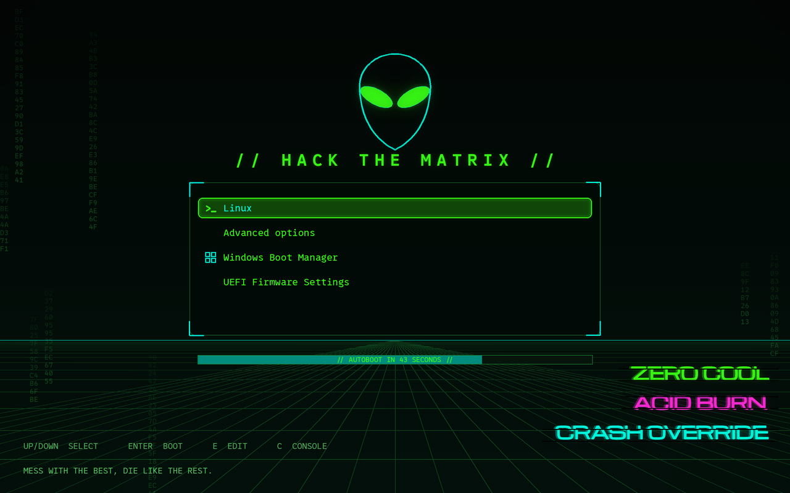
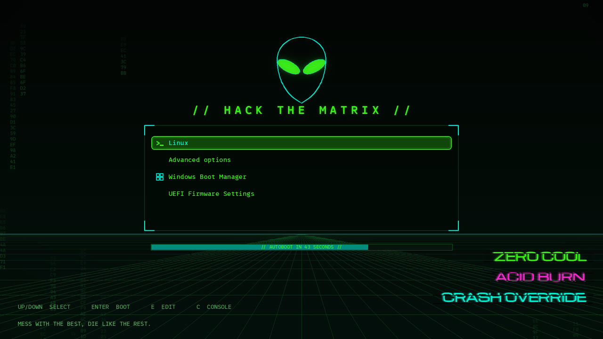
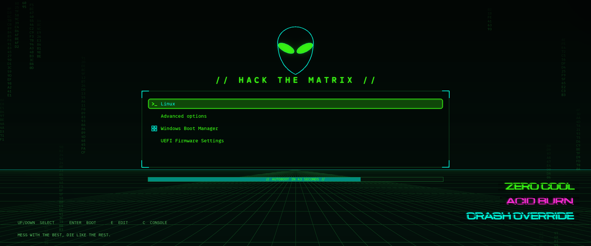
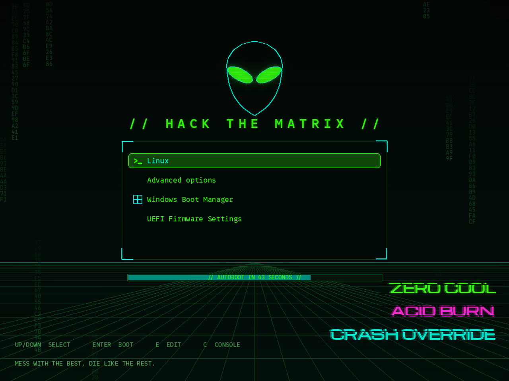

# grub-theme-hackers

> *"Mess with the best, die like the rest."*

A GRUB 2 boot-menu theme in the spirit of the 1995 film **Hackers**: a black
screen with a neon-green perspective grid, scanlines and hex rain, a glowing
wireframe alien, the motto **// HACK THE MATRIX //**, a translucent menu
panel with a glowing selection box, and the handles **ZERO COOL**, **ACID
BURN** and **CRASH OVERRIDE** rendered in a wide Eurostile-style face with the
film's horizontal glitch cut.

Every pixel is generated by a small Python script, so the theme is built for
**any screen resolution** without stretching or blurry upscaling, and every
text on it can be changed with a flag.



<details>
<summary>More previews</summary>

| 1920x1080 (16:9) | 3440x1440 (ultrawide) | 1024x768 (4:3) |
|---|---|---|
|  |  |  |

</details>

## Features

- Built for the exact resolution of your panel; prebuilt assets ship for the eleven most common ones, anything else is generated on install.
- Fonts converted to GRUB's PF2 format at the right pixel size for each resolution (menu, countdown).
- Glowing nine-slice selection box, per-OS icons (Linux prompt, Windows panes, memory test chip, gear for firmware entries).
- Countdown progress bar: `// AUTOBOOT IN 9 SECONDS //`.
- One-command installer for Debian/Ubuntu, Fedora/RHEL and Arch; backs up `/etc/default/grub`, tags every line it writes, has `--dry-run`, and a matching uninstaller.
- Everything configurable: motto, handles and their colors, footer quote, key help, countdown text, alien and rain on/off.
- No trademarked artwork: the alien head is an original wireframe drawing.

## Supported resolutions

Prebuilt in `dist/`:

| 16:9 | 16:10 | Other |
|---|---|---|
| 1366x768 | 1280x800 | 1024x768 (4:3) |
| 1600x900 | 1920x1200 | 3440x1440 (21:9) |
| 1920x1080 | 2560x1600 | |
| 2560x1440 | 3840x2400 | |
| 3840x2160 | | |

Any other size: `python3 build.py --res WIDTHxHEIGHT` (the installer does this
automatically when Pillow and `grub-mkfont` are available).

## Requirements

- GRUB 2 with graphical output (`gfxterm`), i.e. practically every Linux desktop install.
- To install a prebuilt resolution: nothing else.
- To build (custom resolution or custom texts): `python3`, Pillow and `grub-mkfont`.

| Distro | Packages |
|---|---|
| Debian / Ubuntu | `sudo apt install python3-pil grub-common` |
| Fedora | `sudo dnf install python3-pillow grub2-tools` |
| Arch | `sudo pacman -S python-pillow grub` |

## Install

```bash
git clone https://github.com/davidfdr/grub-theme-hackers.git
cd grub-theme-hackers
sudo ./install.sh
```

The installer detects the panel resolution from `/sys/class/drm`, copies the
matching theme to `/boot/grub/themes/hackers` (or `/boot/grub2/...`), sets
`GRUB_THEME`, `GRUB_GFXMODE` and `GRUB_TIMEOUT_STYLE=menu` in
`/etc/default/grub` (after backing it up), and regenerates `grub.cfg`. Reboot
to see it.

Options:

| Flag | Effect |
|---|---|
| `--res WxH` | Force a resolution instead of detecting it |
| `--timeout N` | Set `GRUB_TIMEOUT` (seconds the menu stays before booting the default) |
| `--hide-memtest` | Ubuntu/Debian: hide the memory-test entries (`GRUB_DISABLE_MEMTEST=true`) |
| `--theme-dir DIR` | Install somewhere other than `<grub dir>/themes/hackers` |
| `--dry-run` | Print what would be done; change nothing (no root needed) |

Example for a laptop that dual-boots Windows and should show the menu for 10 seconds:

```bash
sudo ./install.sh --timeout 10 --hide-memtest
```

### Manual install

Copy `dist/<WxH>/` to `/boot/grub/themes/hackers/`, then in `/etc/default/grub`:

```
GRUB_THEME="/boot/grub/themes/hackers/theme.txt"
GRUB_GFXMODE=1920x1080,auto
GRUB_TIMEOUT_STYLE=menu
```

and run `sudo update-grub` (Debian/Ubuntu), `sudo grub2-mkconfig -o /boot/grub2/grub.cfg`
(Fedora) or `sudo grub-mkconfig -o /boot/grub/grub.cfg` (Arch).

## Customize

All texts are flags of `build.py`. Build into `dist/`, then run the installer
(or copy by hand).

```bash
# the shipped design
python3 build.py --res 2560x1600

# a different motto and your own handles (colors: green, pink, cyan, dim, amber, white or #rrggbb)
python3 build.py --res 1920x1080 \
  --motto "// HACK THE PLANET //" \
  --handle "ZERO COOL:green" --handle "ACID BURN:pink" --handle "CRASH OVERRIDE:cyan" \
  --quote "There is no right and wrong. There's only fun and boring." \
  --countdown "// GIBSON ONLINE IN %d //"

# minimal: no alien, no hex rain, no footer
python3 build.py --res 1920x1080 --no-alien --no-rain --quote "" --help-text ""

# everything that is committed (all resolutions + previews)
python3 build.py --all --preview
```

`python3 build.py --help` lists every option. Colors of the grid, panel and
menu live at the top of `build.py` (`PALETTE`) and in `theme_txt()`.

## Uninstall

```bash
sudo ./uninstall.sh                   # remove theme + the lines the installer added
sudo ./uninstall.sh --restore-backup  # or restore the newest /etc/default/grub backup
```

## Troubleshooting

- **I don't see the menu at all.** `GRUB_TIMEOUT_STYLE` is `hidden`, or
  `GRUB_TIMEOUT=0`. The installer sets `menu`; hold `Shift` (BIOS) or `Esc`
  (UEFI) during boot to force the menu, or use `--timeout N`.
- **Ubuntu shows a 10-second menu although I set 0.** Ubuntu's os-prober
  script forces a visible 10-second menu when it finds another OS. Set a
  small positive timeout instead, for example `--timeout 2`.
- **Text, no graphics.** `GRUB_TERMINAL=console` (or `GRUB_TERMINAL_OUTPUT`)
  disables the graphical terminal. The installer comments it out and tells you.
- **Looks stretched or blurry.** The theme was not built for your panel.
  `sudo ./install.sh --res <your WxH>` builds it (needs Pillow and
  `grub-mkfont`), or pick the closest prebuilt one.
- **Firmware rejects the mode.** GRUB falls back to the next entry of
  `GRUB_GFXMODE` (`auto`), and `desktop-image-scale-method: stretch` keeps the
  background full-screen.
- **Secure Boot / NVIDIA / Wayland.** Irrelevant: the theme runs inside GRUB
  before any OS driver loads.

## How it is made

`build.py` draws the background as layers with Pillow: gradient and vignette,
perspective grid, hex rain, the alien (half ellipse plus two quadratic
Béziers, almond eyes), the motto, the menu panel, the glitch-cut handles,
footer texts and scanlines. Glows are Gaussian-blurred copies of the shape
composited underneath. It also renders the nine-slice selection box and the
icons, converts the fonts with `grub-mkfont`, and writes `theme.txt` with
sizes computed for the resolution. The reference design is 2560x1600; every
position is a fraction of the screen and every size is multiplied by
`height / 1600`, so the look is identical on a 768p netbook and a 4K monitor.

See [AGENTS.md](AGENTS.md) for the repository map, commands and rules if you
want to change or extend it.

## Credits and licenses

- Code: MIT, see [LICENSE](LICENSE).
- [Michroma](https://github.com/googlefonts/Michroma-font) by Vernon Adams and the Michroma Project Authors, SIL Open Font License 1.1 (`fonts/LICENSE-Michroma-OFL.txt`).
- [0xProto](https://github.com/0xType/0xProto) by 0xType, SIL Open Font License 1.1 (`fonts/LICENSE-0xProto.txt`).
- *Hackers* (1995) is a film by Iain Softley, produced by United Artists / MGM. This is a fan tribute; the short quotes and handles are used as cultural references. The project is not affiliated with or endorsed by the film's rights holders, nor with Dell or Alienware (it was first drawn for an Alienware laptop, hence the alien).
- Built by David Reis with help from Claude Code.
